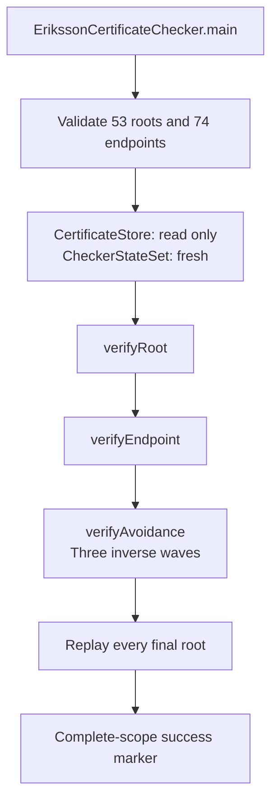
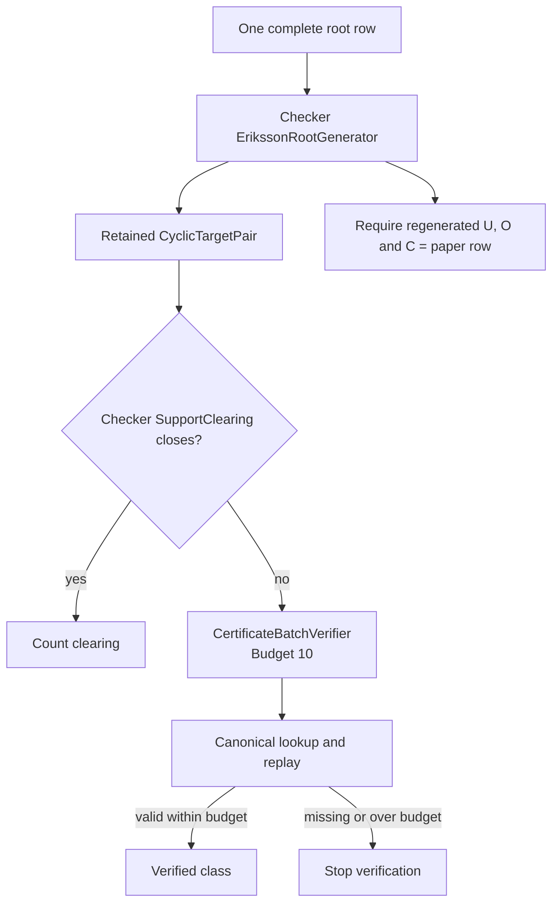
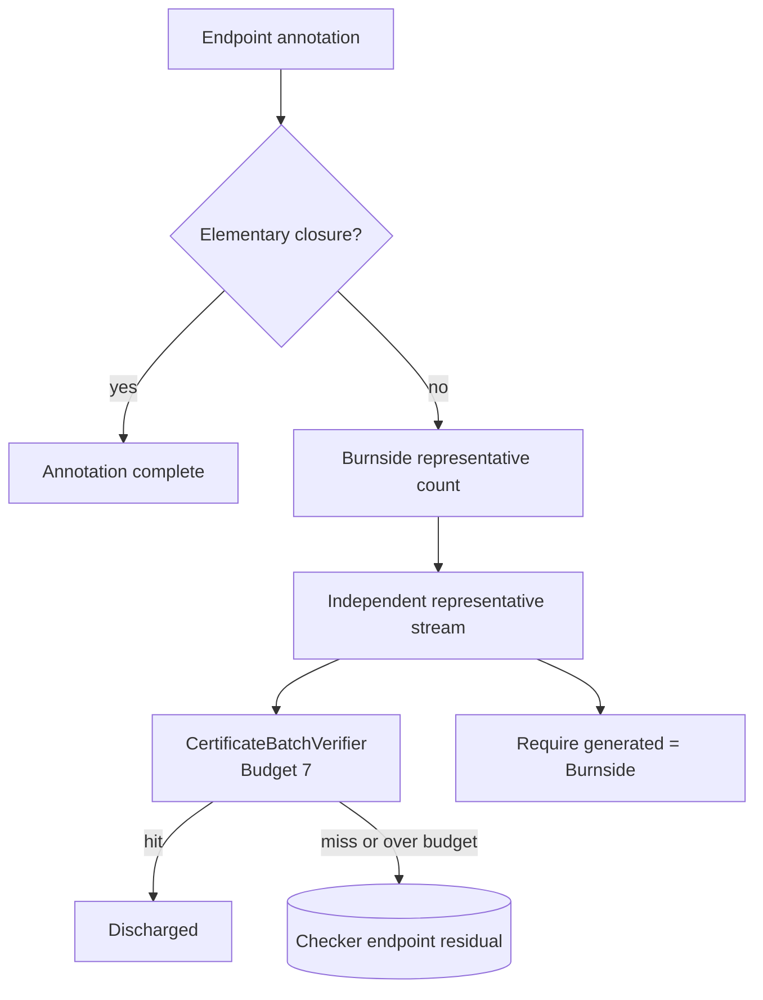
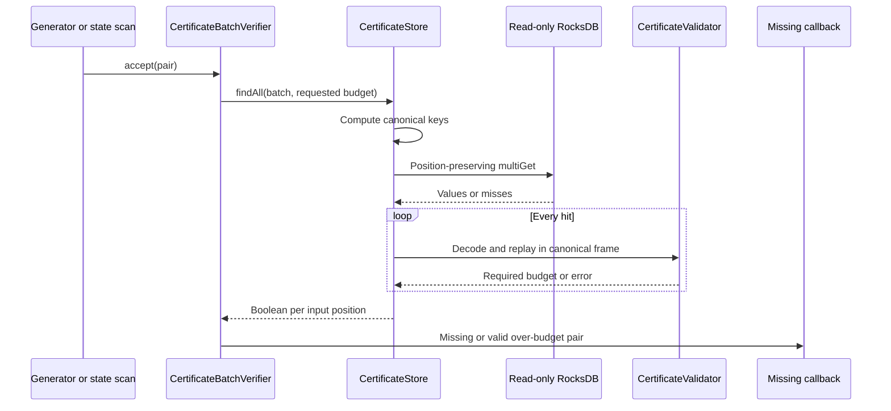
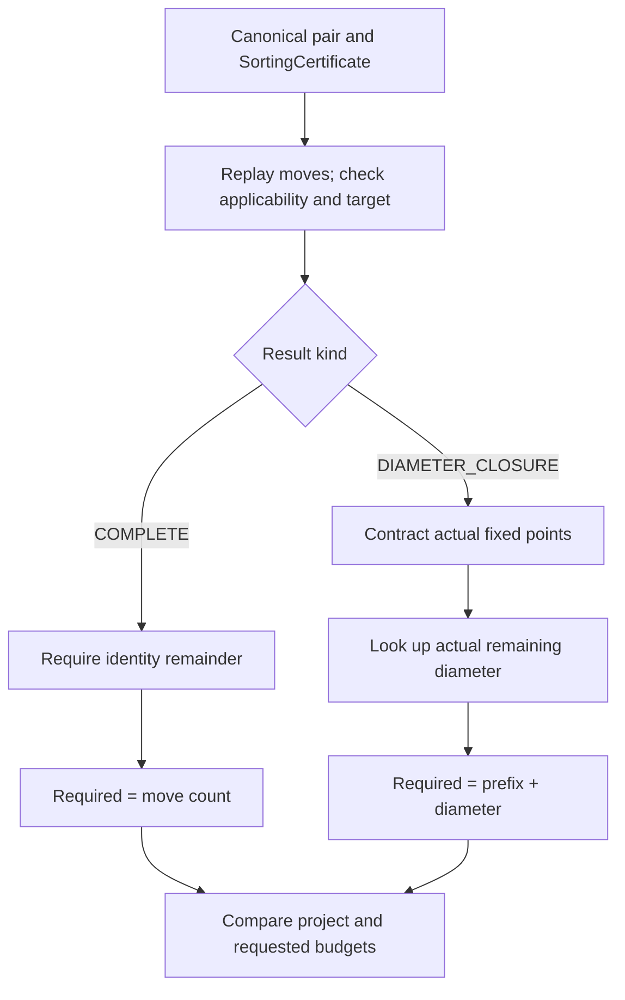
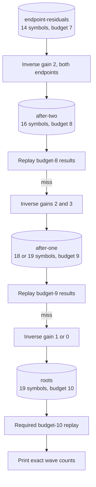
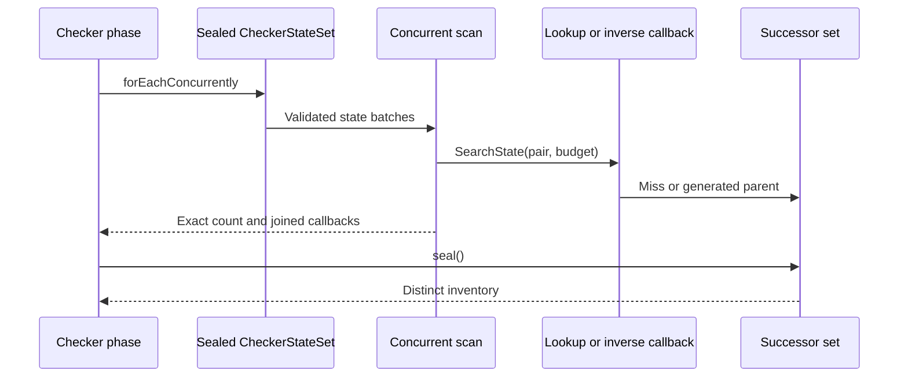

# Checker component interactions

The checker regenerates TD(18) obligations and reads intrinsic results from the
certificate database. It performs no search. See the [execution map](EXECUTION.md)
and [emitter walkthrough](EMITTER_EXECUTION.md) for the connecting artifacts.

## 1. Independent coordinator

[CertificateChecker](../checker/src/main/java/br/unb/cic/td18/CertificateChecker.java)
dispatches to
[ErikssonCertificateChecker](../checker/src/main/java/br/unb/cic/td18/verification/ErikssonCertificateChecker.java).
It loads the paper inventory, opens the source database read-only and creates
fresh checker-owned scratch.

Structural-only and restricted executions validate only their requested scope.
Only an unfiltered `--phase=all` run reaches the complete TD(18) marker. Emitter
checkpoints, obstruction lists and work sets do not supply obligations.

## 2. Root verification

The checker regenerates every selected row, including zero-direct rows.
[ErikssonRootGenerator](../checker/src/main/java/br/unb/cic/td18/joint/ErikssonRootGenerator.java)
and [SupportClearing](../checker/src/main/java/br/unb/cic/td18/joint/SupportClearing.java)
are checker-owned implementations.

## 3. Endpoint verification

The residual callback uses the regenerated pair directly and never asks whether
an obstruction marker exists. Zero-realization non-elementary types still pass
count/generation agreement. The implementations are
[ErikssonInventory](../checker/src/main/java/br/unb/cic/td18/joint/ErikssonInventory.java),
[DirectTwistedBraceletGenerator](../checker/src/main/java/br/unb/cic/td18/bracelet/DirectTwistedBraceletGenerator.java)
and [TwistedBraceletBurnsideCounter](../checker/src/main/java/br/unb/cic/td18/bracelet/TwistedBraceletBurnsideCounter.java).

## 4. Batched lookup and replay

[CertificateBatchVerifier](../checker/src/main/java/br/unb/cic/td18/verification/CertificateBatchVerifier.java)
collects bounded batches and limits concurrent lookup pipelines. Closing it
processes the final partial batch.

[CertificateStore](../checker/src/main/java/br/unb/cic/td18/certificate/CertificateStore.java)
requires the version-2 schema and `joint-selection-v3` marker. A stored key does
not establish that an input pair is canonical; the store compares normalized
images or reconstructs the canonical pair before replay. Malformed records and
invalid moves are errors. A valid result exceeding the requested budget is a
normal phase miss.

## 5. Replay boundary

[CertificateValidator](../checker/src/main/java/br/unb/cic/td18/certificate/CertificateValidator.java)
applies every stored transposition to fresh state.

The replay-derived requirement decides whether a result discharges the current
obligation. Neither a result label nor a recorded move count is trusted alone.

## 6. Independent inverse coverage

`verifyAvoidance()` builds fresh disk-backed sets from regenerated endpoint
residuals.

[ErikssonInverseReconstruction](../checker/src/main/java/br/unb/cic/td18/joint/ErikssonInverseReconstruction.java)
uses checker-owned permutation multiplication and sequential insertion. It
covers every support and gap, swaps endpoints explicitly and replays forward
gain. `requireStage()` checks each domain and budget. Every miss expands through
all applicable next branches; an empty successor still requires a full scan.

## 7. Checker state storage

[CheckerStateSet](../checker/src/main/java/br/unb/cic/td18/verification/CheckerStateSet.java)
wraps [CheckerStateStorage](../checker/src/main/java/br/unb/cic/td18/verification/CheckerStateStorage.java).
Canonical keys include the explicit budget. Bounded batches are partitioned
among deterministic writer shards, deduplicated, written without WAL and flushed
before sealing.

Malformed keys, nonempty values, callbacks, iterator failures and count
disagreements abort verification. Fresh work prevents emitter scratch from
becoming a proof input.

## 8. Complete success boundary

| Phase | Required completed work |
| --- | --- |
| Root row | Independent generation, all count comparisons, clearing and budget-10 replay. |
| Endpoint type | Burnside count, generation, budget-7 classification and count equality. |
| After two | Every endpoint residual expanded and every class classified at budget 8. |
| After one | Every after-two miss expanded through both branches and classified at budget 9. |
| Final roots | Every after-one miss expanded through gain one or zero; every root replayed at budget 10. |
| Application | All work joined with no missing result; complete scope prints the success marker. |

The [reference execution](REFERENCE_SIMULATION.md) completed this boundary with
19 endpoint residuals, 25,544 after-two classes, 6,451,327 after-one classes,
1,349,910,890 final roots and zero missing result. Retained logs and settings are
catalogued in [logs/reference](../logs/reference/README.md).
