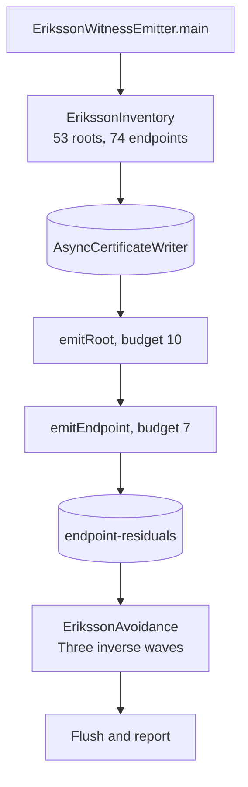
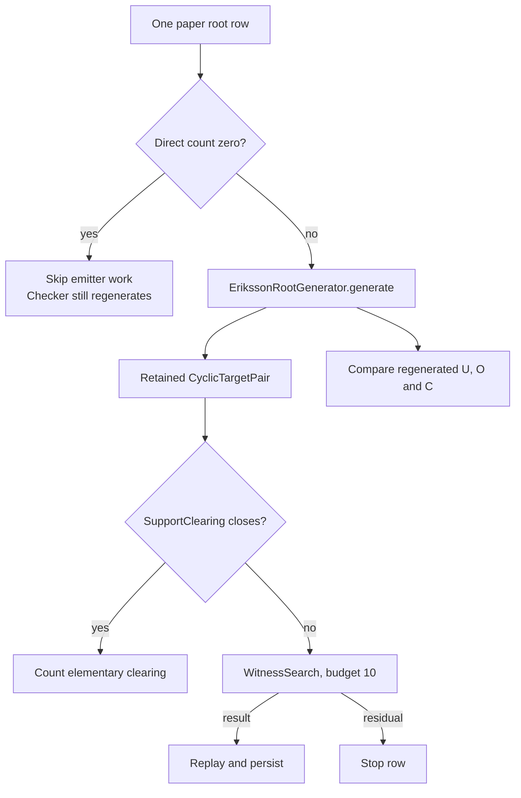
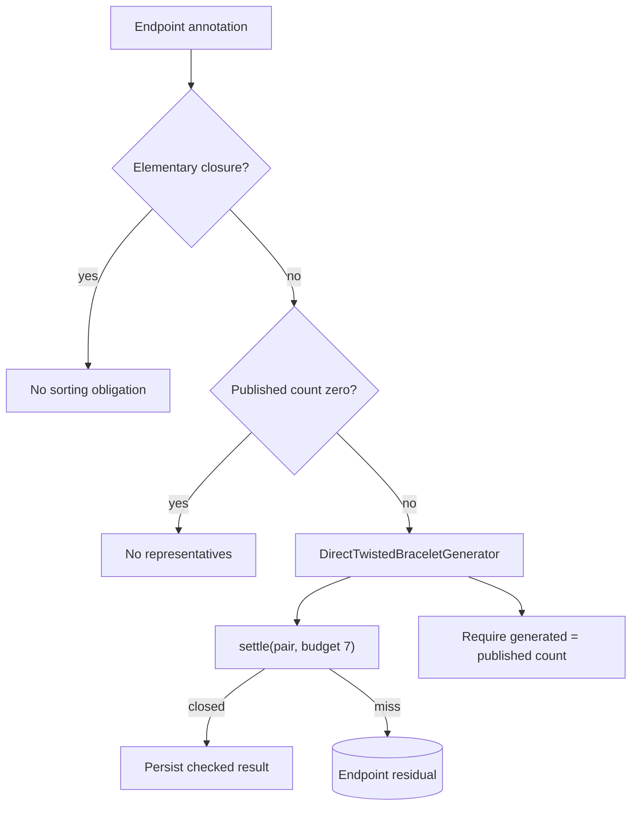
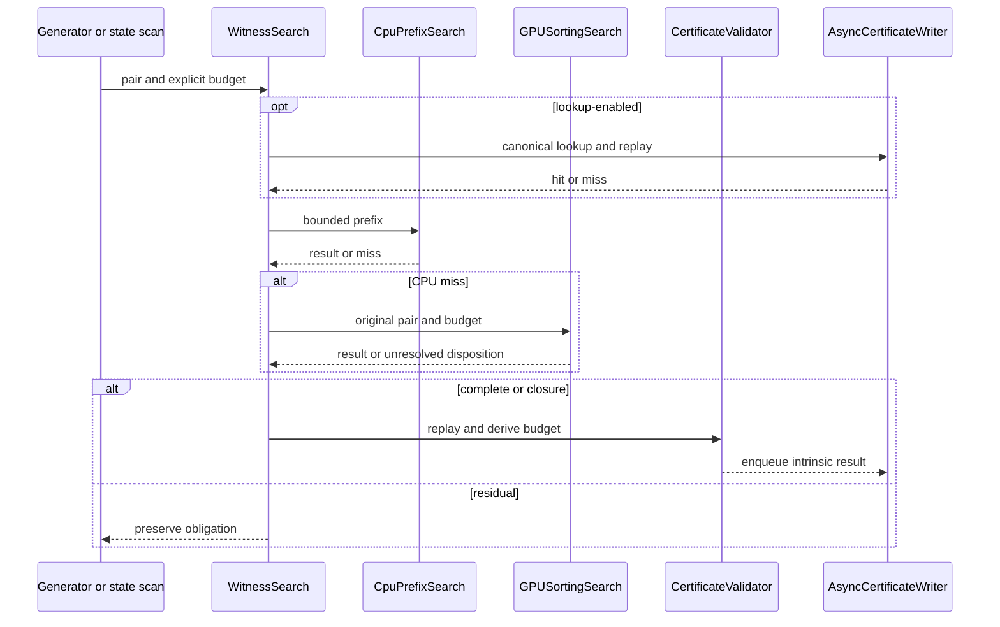
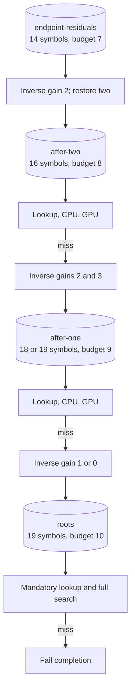
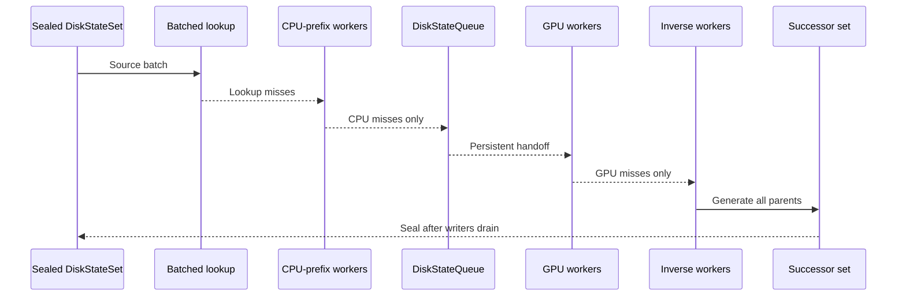

# Emitter component interactions

The emitter generates active TD(18) obligations, searches for intrinsic results
and persists replayable certificates. See the [execution map](EXECUTION.md) for
shared representations and the [checker walkthrough](CHECKER_EXECUTION.md) for
independent verification.

## 1. Coordinator

[WitnessEmitter](../emitter/src/main/java/br/unb/cic/td18/WitnessEmitter.java)
dispatches to
[ErikssonWitnessEmitter](../emitter/src/main/java/br/unb/cic/td18/emission/ErikssonWitnessEmitter.java).
The coordinator reads the paper inventory, creates fresh work, opens the
certificate writer and installs it as the search result sink.

The completion message describes only the requested emitter scope. Independent
verification remains required.

## 2. Direct roots

[ErikssonRootGenerator](../emitter/src/main/java/br/unb/cic/td18/joint/ErikssonRootGenerator.java)
uses normalized algebraic cycles, prefix placement and two-sided selection.
[SupportClearing](../emitter/src/main/java/br/unb/cic/td18/joint/SupportClearing.java)
implements only the paper's explicit patterns. Writer flush completes each row's
persistence boundary.

## 3. Endpoints

[DirectTwistedBraceletGenerator](../emitter/src/main/java/br/unb/cic/td18/bracelet/DirectTwistedBraceletGenerator.java)
constructs fixed-content representatives. A configured
[ReadOnlyWitnessSource](../emitter/src/main/java/br/unb/cic/td18/certificate/ReadOnlyWitnessSource.java)
may supply a result, but it is replayed and copied through the ordinary TD(18)
writer. Avoidance-only emission derives misses from actual database lookup;
obstruction markers do not select work.

## 4. Witness search

[WitnessSearch](../emitter/src/main/java/br/unb/cic/td18/search/WitnessSearch.java)
owns lookup, CPU-prefix and CUDA boundaries. Direct unique generation starts a
fresh search; reconstruction first performs batched database lookup.

[CpuPrefixSearch](../emitter/src/main/java/br/unb/cic/td18/search/CpuPrefixSearch.java)
tries gain-at-least-two, gain-one and gain-zero supports within its limits. It
accepts only identity or a replayable diameter closure.
[GPUSortingSearch](../emitter/src/main/java/br/unb/cic/td18/base/GPUSortingSearch.java)
dispatches the restricted CUDA sorting tree. Exhaustion, caps, depth limits and
timeouts leave the input unresolved. Budget-10 final roots use full depth 10
without a time cutoff.

The native path is implemented by
[jni_sorter.cu](../emitter/src/native/jni/jni_sorter.cu),
[slot_manager.cu](../emitter/src/native/backtracking/slot_manager.cu) and
[sorting_search.cu](../emitter/src/native/backtracking/sorting_search.cu).

## 5. Three inverse waves

[ErikssonAvoidance](../emitter/src/main/java/br/unb/cic/td18/avoidance/ErikssonAvoidance.java)
seals each wave before using it as the next source.
[ErikssonInverseReconstruction](../emitter/src/main/java/br/unb/cic/td18/avoidance/ErikssonInverseReconstruction.java)
restores fixed symbols in every gap, covers both endpoints and replays the
forward gain.

## 6. CPU, GPU and inverse pools

[ReconstructionPipeline](../emitter/src/main/java/br/unb/cic/td18/avoidance/ReconstructionPipeline.java)
keeps source scanning, GPU dispatch and inverse generation independent.

Coverage equalities account for every source, GPU input and inverse input. A
failed worker aborts both disk queues and prevents sealing.

## 7. Persistence and root prefetch

[DiskStateSet](../emitter/src/main/java/br/unb/cic/td18/avoidance/DiskStateSet.java)
and [StateSetWriter](../emitter/src/main/java/br/unb/cic/td18/avoidance/StateSetWriter.java)
use bounded producer batches, deterministic shards, sorted SST files and
WAL-free ingestion. Duplicate occurrences become one key.

During final inverse generation,
[RootPrefetch](../emitter/src/main/java/br/unb/cic/td18/avoidance/RootPrefetch.java)
performs batched lookup, sends misses through parallel CPU-prefix workers and
sends only CPU misses to time-sliced GPU search. Queue pressure may drop
advisory work because the sealed root set is scanned exhaustively afterwards.

## 8. Completion boundary

[ErikssonCheckpoint](../emitter/src/main/java/br/unb/cic/td18/avoidance/ErikssonCheckpoint.java)
records sealed stages with the route, budgets and exact counts. Resume validates
the complete source during mandatory processing. Emitter success requires all
generation, search and persistence work to join, every count comparison to pass,
every final root to close within budget 10 and the unresolved count to be zero.
The independent checker then verifies the resulting database.
