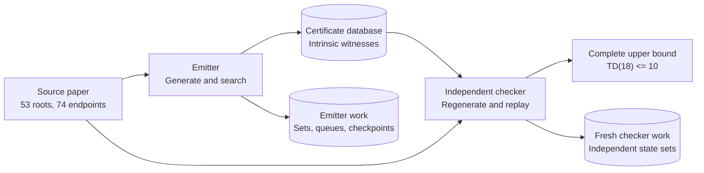
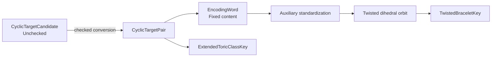
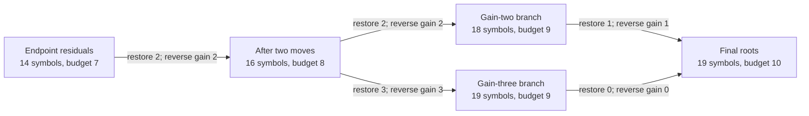

# TD(18) proof execution map

This guide connects the mathematical route to the emitter, certificate database
and independent checker. The [source paper](td18-reduction-count.tex) defines
the proof. The [emitter walkthrough](EMITTER_EXECUTION.md) and
[checker walkthrough](CHECKER_EXECUTION.md) expand the executable sides.

## 1. Complete proof flow

The database contains replayable results. Emitter work sets and checkpoints
schedule computation but do not define checker obligations. The checker reads
the database, creates fresh work and regenerates every selected root, endpoint
and inverse wave. [checker/pom.xml](../checker/pom.xml) has no emitter dependency.

## 2. Mathematical and persisted representations

A cyclic-target pair is `(omega, beta)`, with target `rho = omega * beta`.
Generation may first construct an unchecked
[CyclicTargetCandidate](../emitter/src/main/java/br/unb/cic/td18/model/CyclicTargetCandidate.java);
only its checked conversion produces a valid pair. Fixed points are contracted
before fixed-point-free generation or reconstruction-state encoding.

Twisted reflection reverses positions and inverts oriented cyclic ranks. A
twisted bracelet is the orbit, rather than one chosen word. The principal
implementations are
[CyclicTargetPair](../emitter/src/main/java/br/unb/cic/td18/model/CyclicTargetPair.java),
[EncodingWord](../emitter/src/main/java/br/unb/cic/td18/model/EncodingWord.java),
[StandardizedEncodingWord](../emitter/src/main/java/br/unb/cic/td18/model/StandardizedEncodingWord.java),
[DihedralOrbitWord](../emitter/src/main/java/br/unb/cic/td18/model/DihedralOrbitWord.java),
[TwistedBraceletKey](../emitter/src/main/java/br/unb/cic/td18/model/TwistedBraceletKey.java)
and [ExtendedToricClassKey](../emitter/src/main/java/br/unb/cic/td18/model/ExtendedToricClassKey.java).

## 3. Domains, budgets and inverse waves

Every inverse generator covers both endpoints, every required support and every
cyclic gap, then replays the actual forward gain. The emitter deduplicates each
wave on disk; the checker independently rebuilds the same class sets. The active
route also includes two direct root classes at budget 10.

## 4. Responsibility boundary

| Boundary | Emitter | Independent checker |
| --- | --- | --- |
| Root inventory | Reads published rows, generates nonzero direct work and searches it. | Regenerates every selected row and compares retained unoriented, retained oriented and support-cleared counts. |
| Endpoint inventory | Uses published counts, generates representatives and searches them. | Computes Burnside counts, generates representatives and checks equality. |
| Witness | CPU prefix and CUDA search create a result; Java replays before persistence. | Reads and replays every stored move at the requested budget. |
| Endpoint miss | Persists an endpoint residual state. | Derives a residual directly from missing or over-budget replay. |
| Inverse waves | Searches each source, expands every miss and persists canonical classes. | Regenerates every predecessor from checker-owned residual sets. |
| Final root | Requires a budget-10 result. | Fails on any missing or over-budget result. |

Obstruction markers are advisory emitter metadata. Neither their presence nor
absence changes the checker's generated scope.

## 5. Runtime artifacts

| Artifact | Meaning | Proof role |
| --- | --- | --- |
| Certificate database, format 2 | Canonical key to complete witness or diameter prefix; separate obstruction family. | Checker input; every required hit is decoded and replayed. |
| `DiskStateSet` / `CheckerStateSet` | Disk-backed deduplicated states with explicit budgets. | Phase inventories; checker creates its own sets. |
| `DiskStateQueue` | Fixed-size CPU-to-GPU and GPU-to-inverse handoff records. | Temporary scheduling state with exact final counts. |
| `ErikssonCheckpoint` | Emitter stage, route, budgets and completed counts. | Resume boundary only; never checker evidence. |
| Progress and statistics | Source progress, queues, search outcomes and persistence work. | Operational visibility, not proof coverage. |

Certificate writes disable WAL and flush explicitly. State writers use bounded
producer batches, deterministic shards and sorted SST ingestion. Interrupted
output is regenerated from the latest sealed source.

## 6. Main components

| Component | Current role |
| --- | --- |
| `ErikssonRoute`, `ErikssonInventory`, `KnownDiameters` | Domains, budgets, published inventory and smaller diameter closures. |
| `ErikssonRootGenerator`, `SupportClearing` | Direct root generation, active counts and explicit elementary clearing. |
| `DirectTwistedBraceletGenerator`, `TwistedBraceletBurnsideCounter` | Endpoint representatives and independent orbit counts. |
| `WitnessSearch`, `CpuPrefixSearch`, `GPUSortingSearch` | Lookup, CPU prefix, CUDA fallback and result creation. |
| `ErikssonAvoidance`, `ReconstructionPipeline` | Three inverse waves with separate CPU, GPU and inverse pools. |
| `CertificateStore`, `CertificateValidator` | Read-only checker lookup and replay-derived budget validation. |
| `CheckerStateSet`, `CheckerStateStorage` | Checker-owned disk-backed inverse inventories. |

## 7. Completed reference scope

The [reference execution record](REFERENCE_SIMULATION.md) reports a complete
separate-machine checker run with 53 root rows, 74 endpoint annotations, 19
endpoint residuals, 25,544 after-two classes, 6,451,327 after-one classes and
1,349,910,890 final roots. The run printed the complete-scope success marker
and exited zero. Retained artifacts are catalogued under
[logs/reference](../logs/reference/README.md).

For commands and validation boundaries, see [WORKFLOW.md](WORKFLOW.md),
[OPERATIONS.md](OPERATIONS.md) and [VALIDATION.md](VALIDATION.md).
